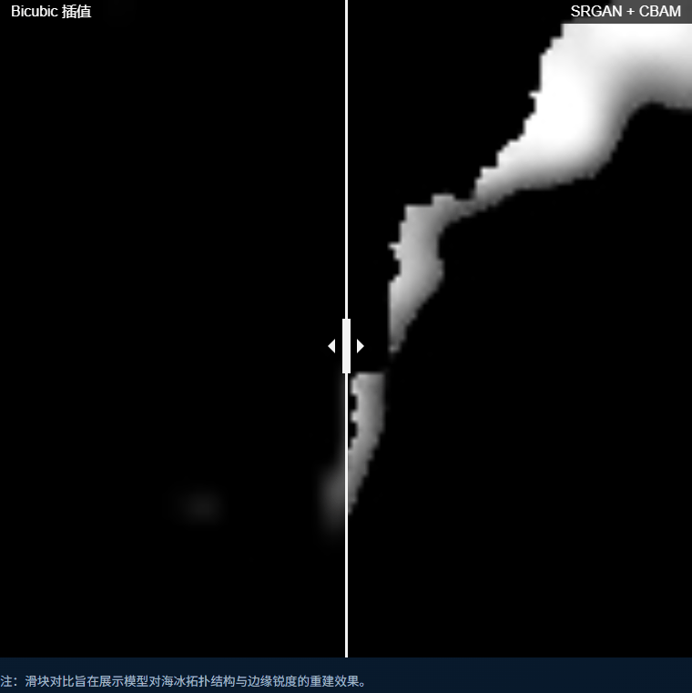
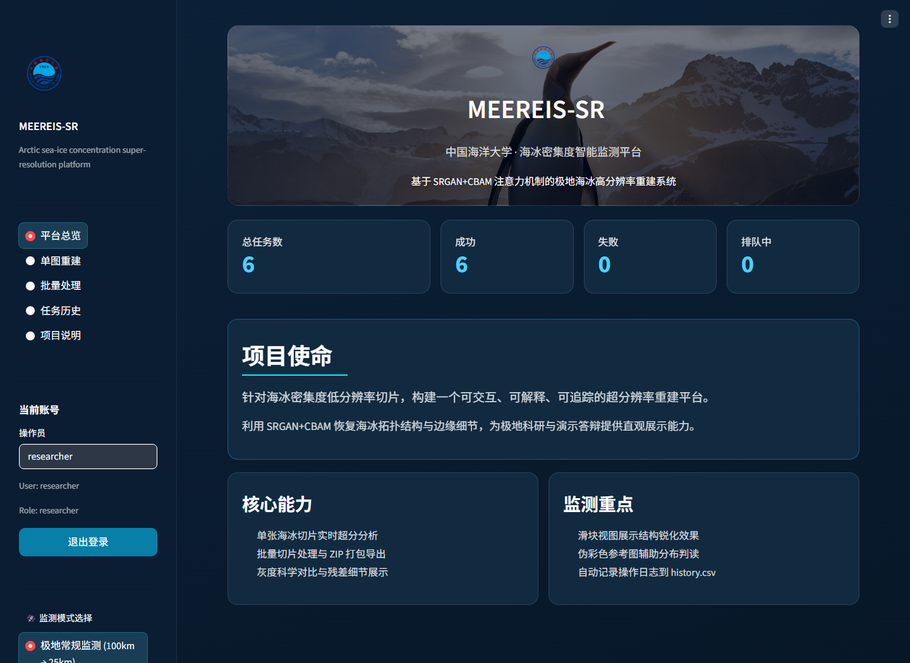
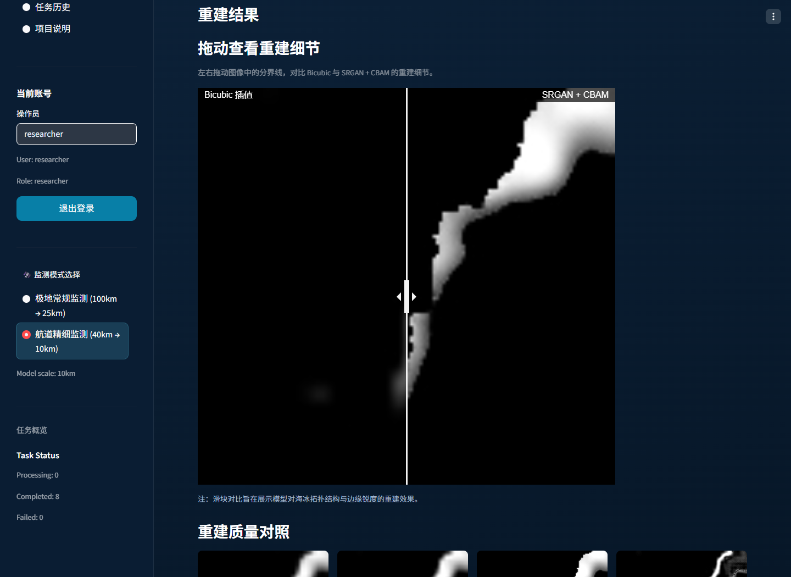
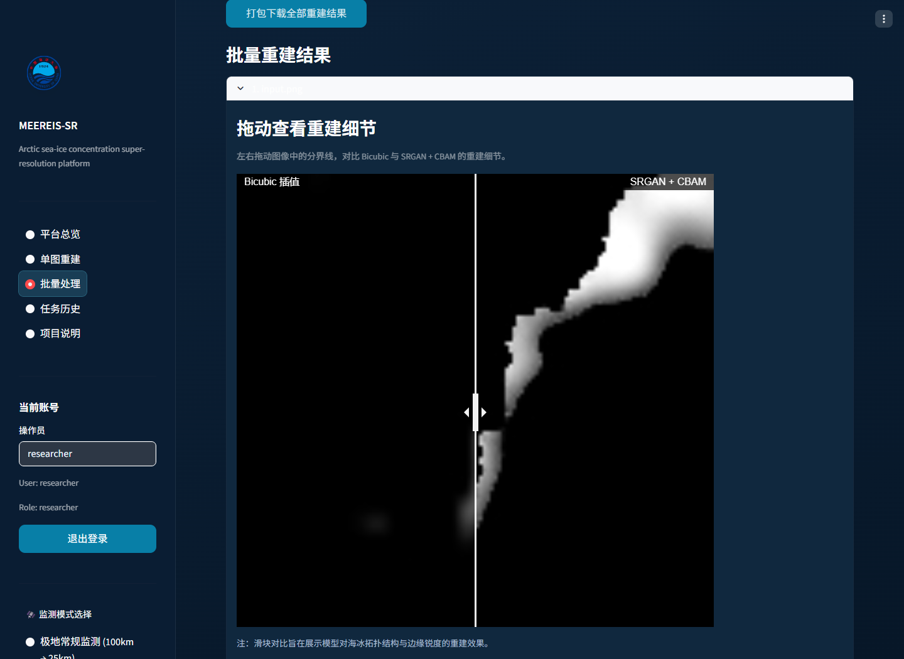
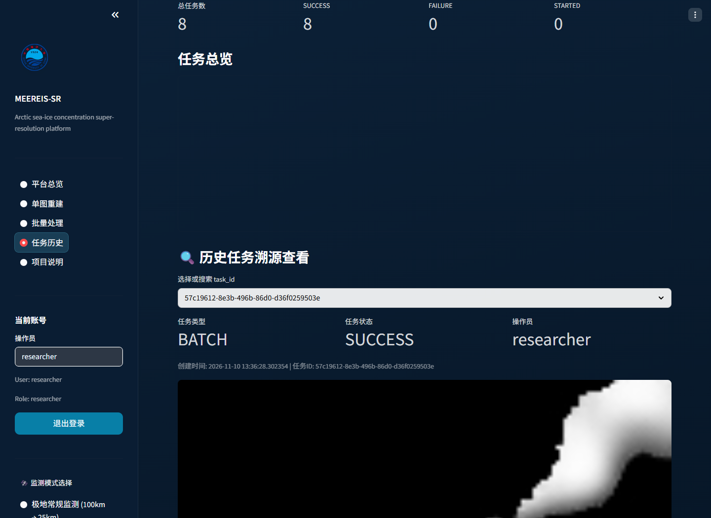
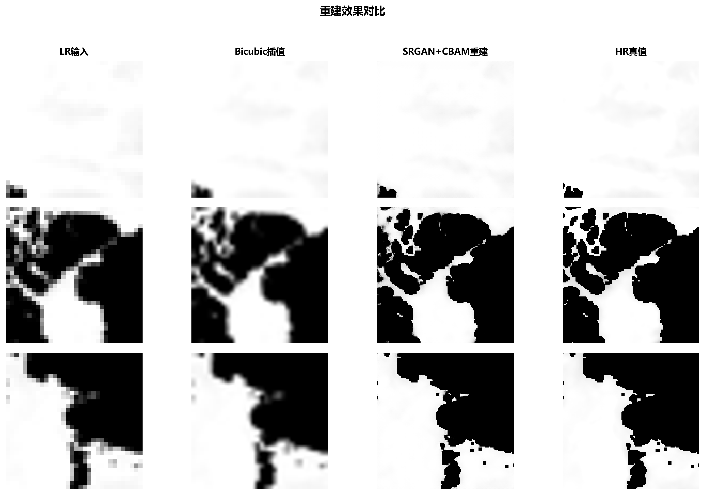
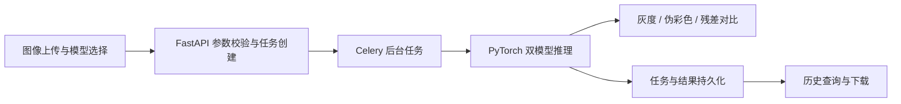

# MEEREIS-SR｜北极海冰超分辨率重建与智能增强平台

**王筱涵 · 独立核心开发 · 中国海洋大学本科毕业设计**

将深度学习重建模型转化为可操作的科研工具：上传海冰图像，选择模型，完成超分辨率重建，查看科学对比图，并追踪历史任务。

**[打开平台效果展示 →](https://wxh042.github.io/meereis-sr/)**　[重建结果](#重建与分析) · [项目成果](#实验结果) · [代码与复现](#代码与复现)

> 展示页包含真实平台截图与已计算样例，浏览无需安装或登录；模型推理服务在本地运行。

## 拖动对比效果

**[点击打开交互对比：直接拖动图像分界线 →](https://wxh042.github.io/meereis-sr/)**

下面是平台原有拖动组件的真实操作录屏。GitHub README 展示动图，点击上方链接可亲自拖动，手机触摸和键盘操作均可使用。

## 平台最终效果

平台支持两种 4× 重建尺度：**100 km → 25 km** 与 **40 km → 10 km**。功能覆盖单图处理、批量推理、灰度与伪彩色展示、结果下载及历史任务查看。

### 重建与分析

上传低分辨率切片后，平台展示输入、Bicubic、SRGAN 与残差，辅以 Viridis / Jet 伪彩色及滑块对比，方便观察结构与边缘变化。

### 批量处理

批量上传后由后台任务执行推理，支持查看逐张结果及下载 ZIP。本次演示真实完成了 2 张图像的批量任务。

### 历史追踪

查看任务状态、模型尺度、处理时间与历史重建结果，形成从提交到结果回溯的交互流程。

## 我的主要工作

| 环节 | 具体实现 |
|---|---|
| 科学数据处理 | 面向 NSIDC、OSI SAF 产品完成 NetCDF 解析、无效值处理、归一化、窗口切片与合成退化配对 |
| 模型结构 | 将 SRGAN 改造为单通道连续物理场重建模型，引入残差特征融合与 CBAM 注意力 |
| 训练优化 | 组合像素、感知和对抗损失，根据判别器输出控制更新频率，缓解训练失衡 |
| 实验分析 | 完成独立测试集评估、CBAM 消融、残差分析与失败案例分析 |
| 平台交付 | 开发 FastAPI 推理接口、Celery 异步任务与 Streamlit 界面，支持双模型、批量处理和任务持久化 |

## 实验结果

**OSI SAF 40 km → 10 km，543 个独立测试样本，Bicubic 合成退化条件。**

| 方法 | PSNR ↑ | SSIM ↑ | RMSE ↓（0–255 灰度） |
|---|---:|---:|---:|
| Bicubic | 21.18 dB | 0.9506 | 23.94 |
| SRGAN + CBAM | **28.19 dB** | **0.9877** | **10.66** |

相较 Bicubic，平均 PSNR 提升 **7.01 dB**；消融实验中，CBAM 相较无 CBAM 基线带来 **0.83 dB** 的平均增益。

[逐样本评价数据](experiments/evaluation_metrics_10km.csv) · [CBAM 消融结果](experiments/ablation_cbam_summary.csv) · [失败案例分析图](docs/failure_case_analysis.png)

## 从模型到平台

**技术栈：** Python、PyTorch、SRGAN、CBAM、NumPy、FastAPI、Celery、Redis、SQLAlchemy、Streamlit。

## 代码与复现

- [模型定义与权重](platform/) · [训练实现](training/) · [数据处理](data_tools/) · [实验评价](experiments/)
- [本地运行与维护说明](docs/MAINTENANCE.md) · [运行验证记录](docs/verification.json)
- 已验证双模型单图、批量任务、状态查询、历史记录、鉴权及异常输入处理。演示环境使用 SQLite 与 Celery 文件队列，也保留 MySQL / Redis 配置方式。

## 研究范围与来源

本项目研究海冰密集度的合成退化超分辨率，结果不等同于真实低分辨率观测的泛化验证；伪彩色用于辅助显示。RMSE 10.66 为灰度误差，不是平均绝对误差。

科学样例来源于 OSI SAF 产品；使用数据应遵循对应使用与引用要求。早期平台原型参考 [Super-Resolution-Model](https://github.com/Nneji123/Super-Resolution-Model)，模型研究参考 SRGAN / ESRGAN 与 CBAM 相关工作。保留来源说明，不对第三方代码授予额外许可。
