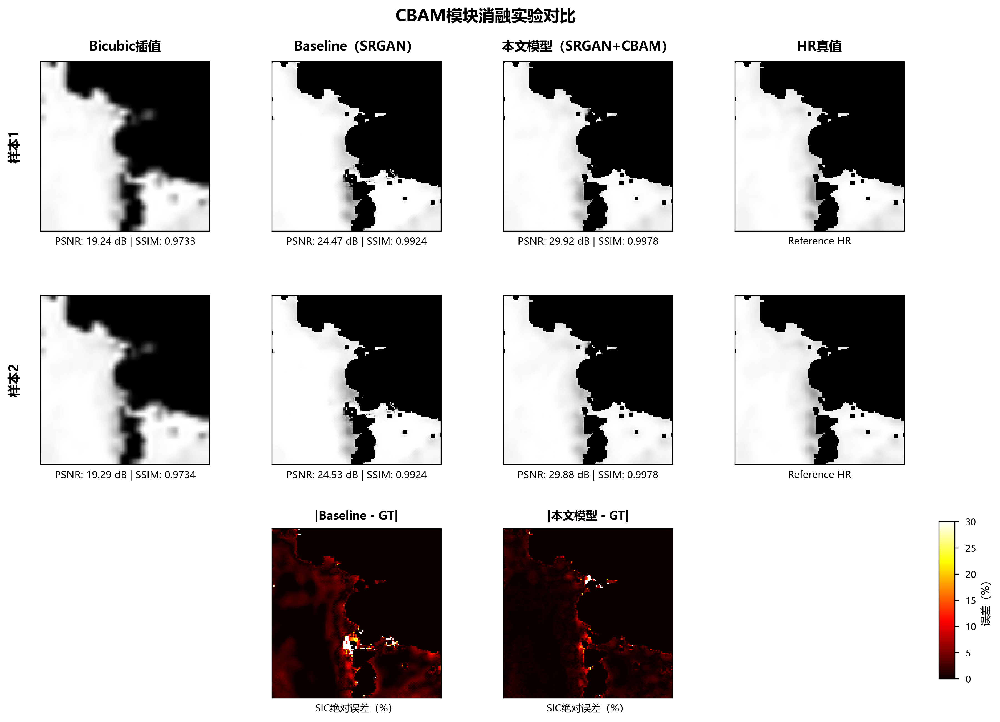

# MEEREIS-SR 北极海冰超分辨率平台

面向海冰密集度（SIC）单通道连续物理场的 4× 超分辨率研究与交互式推理平台。包含真实训练权重、SRGAN / CBAM 网络、训练代码、实验指标、FastAPI + Celery 后端和 Streamlit 界面。

## 项目能力

- 双尺度任务：100 km → 25 km、40 km → 10 km；两套生成器权重各约 3.2 MB，仓库内可直接使用。
- 科学数据：NetCDF 解析、无效像元处理、归一化、切片及 Bicubic 合成退化配对。
- 模型研发：单通道 SRGAN、残差特征融合、CBAM；10 km 训练采用像素、VGG 感知及对抗损失，并根据判别器输出控制更新频率。
- 工程平台：JWT 登录、单张 / 批量推理、任务状态查询、灰度与伪彩色展示、任务历史及结果持久化。
- 科学数值输出不做百分位对比度拉伸；伪彩色只是显示方式，不代表恢复了新的物理观测。

## 研究结果

以下为原实验 CSV 的汇总，不代表本次重新训练。2023 年 1 月合成退化测试集共 543 对样本。

| 方法 | PSNR / dB | SSIM | RMSE（0–255 灰度） |
|---|---:|---:|---:|
| Bicubic | 21.1808 | 0.9506 | 23.9353 |
| SRGAN + CBAM | 28.1873 | 0.9877 | 10.6620 |

对无 CBAM 基线的平均 PSNR 增益为 0.8328 dB；不是每个样本都提升。10.662 / 255 × 100 ≈ 4.18 个 SIC 百分点，属于 RMSE 换算，不能称为 MAE。




## 一键运行与维护

本机主目录 `D:\graduate\meereis-sr`：

- 双击 **启动平台.cmd**：统一启动网页、API 与后台 Worker；关闭时按 Ctrl+C。
- 双击 **验证项目.cmd**：用隔离的临时数据验证双模型、单张/批量任务及错误处理。
- 首次启动自动生成本机登录配置 `runtime/local-config.json`，用户名 `researcher`。
- 默认使用 SQLite + Celery 本地文件队列，不依赖外部数据库或 Redis；原 MySQL/Redis 接口仍支持环境变量配置。

新机器先创建 Python 3.11 `.venv`，按 `requirements.lock.txt` 安装已验证依赖，详见 [维护说明](docs/MAINTENANCE.md)。

```bash
python scripts/infer.py --input examples/input.png --model 10km --output output.png
```

## 目录

- `platform/`：从原项目完整平台整理的业务代码、模型及权重。
- `training/`：25 km、10 km 与无 CBAM 基线训练代码；需自行准备数据，未重复执行完整训练。
- `data_tools/`：原科学数据处理脚本；部分研究脚本需按本地数据位置调整路径。
- `experiments/`：原实验指标与可配置测试集路径的 10 km 评估脚本。
- `docs/verification.json`：本次本机运行验证结果；包括双模型、批量、鉴权与异常输入。
- `examples/`：OSI SAF 科学图像样例及本次推理结果。

## 数据与适用边界

原研究使用 NSIDC / OSI SAF 产品。大体量数据、原始 NetCDF、用户数据库、任务记录、个人配置及训练中间检查点不上传。样例来源于 OSI SAF 海冰浓度产品，使用时应遵循其数据使用与引用要求。样例只用于流程演示，不替代完整测试集。

模型在合成 Bicubic 退化条件下评估，未验证真实低分辨率观测、显微图像或跨领域通用泛化。不包含视觉语言模型、Diffusion 或显微图像识别。GAN 的锐化结果需结合数值误差和物理一致性判断。

本平台从早期超分辨率 API 原型逐步改造；原目录 README 指向 Nneji123/Super-Resolution-Model、SRGAN/ESRGAN 等参考实现。这里仅发布海冰相关实现，保留来源说明；不对第三方代码授予额外许可。
